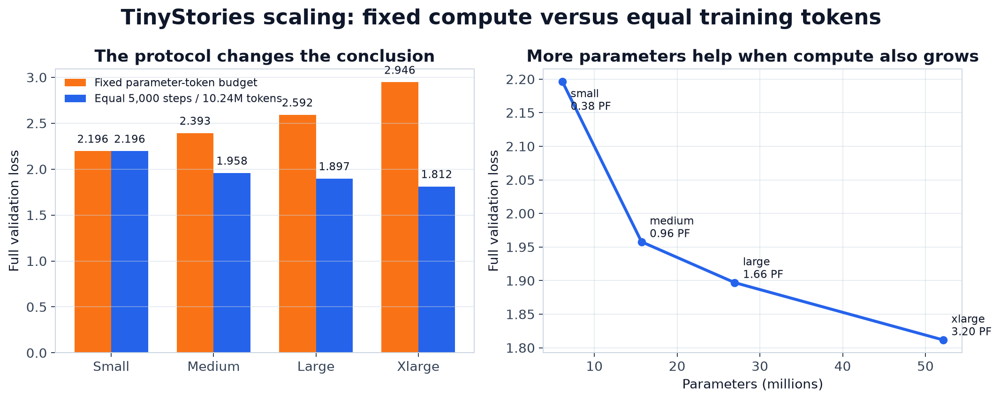
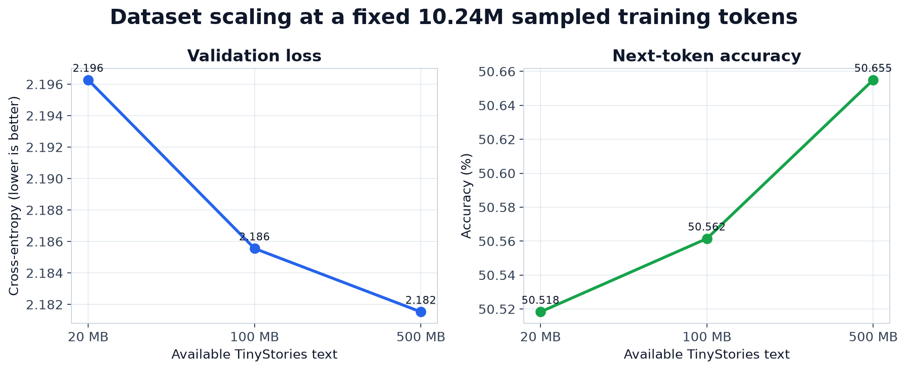
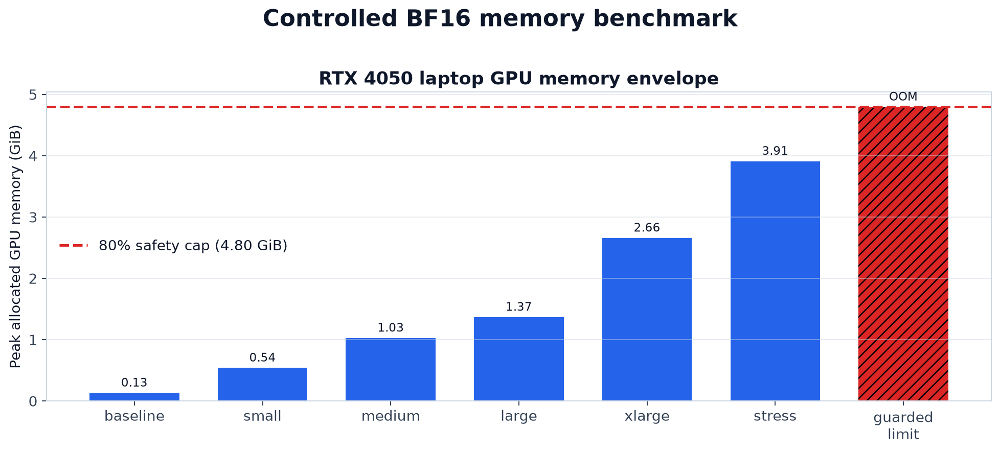
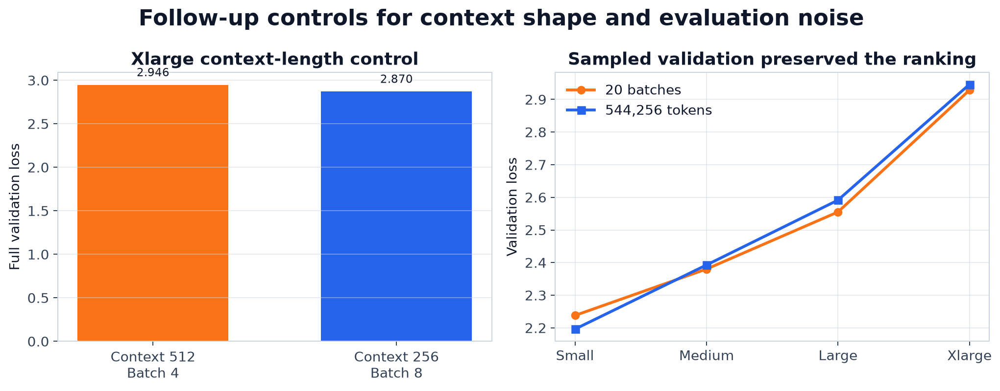
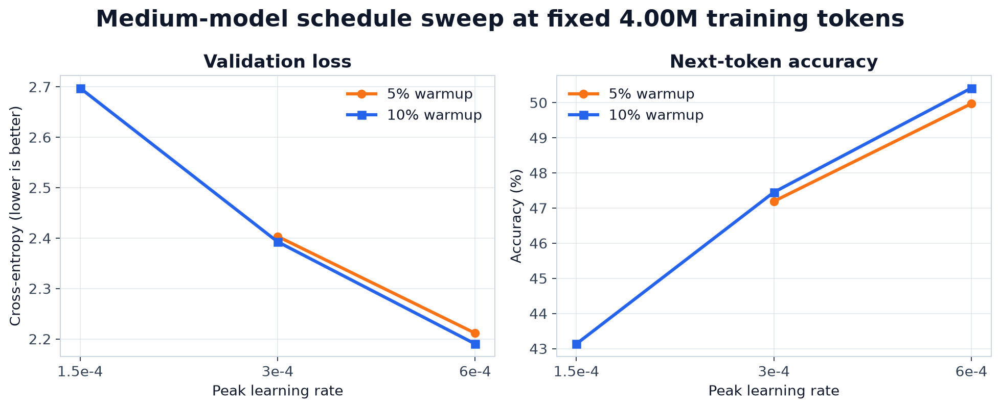
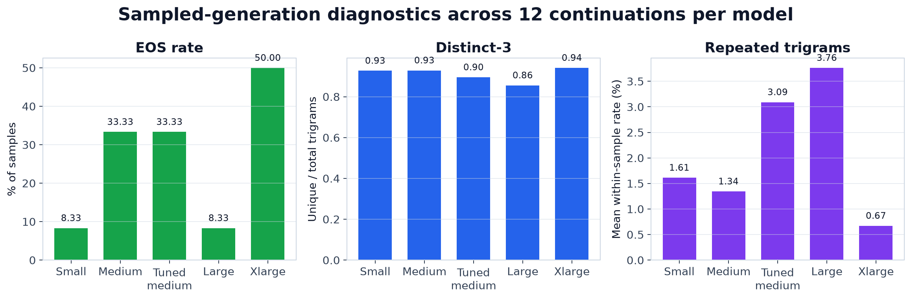

# TinyStories Transformer: implementation and experiment report

## 1. Purpose

The project began as a way to learn the language-model foundations covered in
Stanford CS336 by implementing the stack rather than calling a pretrained
Hugging Face model. It then grew into a laptop-scale study of model size, data size, compute
allocation, optimizer settings, validation noise, memory limits, and generation
quality.

The work was done on Windows with an NVIDIA RTX 4050 Laptop GPU. This matters:
the machine has enough CUDA capability for meaningful experiments, but only 6
GB of VRAM and a variable laptop power state. Those constraints shaped both the
engineering decisions and the claims that can be made from the results.

## 2. What was built

### 2.1 Core neural-network components

The following components were implemented in PyTorch:

- `Linear`: weight-only projection using `x @ W.T`;
- `Embedding`: a learned lookup table from token IDs to vectors;
- `RMSNorm`: root-mean-square normalization with learned scale and no mean subtraction;
- `SwiGLU`: gated feed-forward activation with three linear projections;
- scaled dot-product attention with optional masks;
- causal multi-head self-attention;
- rotary positional embeddings (RoPE) applied to query and key feature pairs;
- pre-norm Transformer blocks with attention and feed-forward residual paths;
- a decoder-only Transformer language model that returns logits.

Softmax is intentionally not applied at the model output during training. The
cross-entropy implementation consumes logits directly and performs the stable
log-sum-exp computation internally.

### 2.2 Training utilities

The project also implements:

- numerically stable softmax and cross-entropy;
- global gradient-norm clipping;
- AdamW, including moment estimates, bias correction, epsilon, and decoupled weight decay;
- linear warmup followed by cosine learning-rate decay;
- random next-token training batches;
- model and optimizer checkpoint save/load;
- resume support;
- JSONL metric logging and training-curve plotting.

### 2.3 Tokenization and data preparation

A byte-level BPE tokenizer was implemented with:

- all 256 byte values as the base vocabulary;
- GPT-2-style pre-tokenization;
- ordered BPE merge application;
- indivisible special tokens such as `<|endoftext|>`;
- streaming encode and round-trip decode support;
- JSON serialization for arbitrary byte tokens.

TinyStories preprocessing streams complete documents rather than loading the
full corpus into memory. Encoded IDs are stored as memory-mapped `uint16`
arrays. The default tokenizer vocabulary is 2,000 entries.

For the 100 MB and 500 MB data experiments, the pure-Python tokenizer was too
slow. An optional `tiktoken` encoding backend was therefore constructed from
the exact vocabulary and merge ranks learned by our tokenizer. It was used only
after two equivalence checks:

1. representative ordinary, Unicode, whitespace, and special-token strings
   produced identical IDs; and
2. the first 271,773 training IDs and 27,064 validation IDs matched the existing
   Python-tokenizer output exactly.

This changed preprocessing speed without changing the tokenized experiment.

### 2.4 Windows compatibility

The upstream tokenizer memory tests import the Unix-only `resource` module.
The tests were adjusted so functional tokenizer tests still run on Windows,
while only the two Unix resource-limit tests are skipped. The final test result
is 46 passed and 2 skipped.

## 3. How the work progressed

The project followed a staged sequence:

1. Inspect the starter code and tests.
2. Make test collection work on Windows.
3. Implement one mathematical component at a time and use the inherited tests
   as executable specifications.
4. Assemble the Transformer only after its layers passed independently.
5. Implement loss, clipping, AdamW, scheduling, and serialization.
6. Implement BPE training, tokenization, and streaming corpus preparation.
7. Build a small end-to-end TinyStories workflow before increasing model size.
8. Verify CUDA-enabled PyTorch and BF16 support.
9. Benchmark GPU memory before committing to long training runs.
10. Add generation, JSONL logging, plotting, and deterministic evaluation.
11. Run an initial fixed-compute scaling comparison.
12. Identify its confounds and design targeted follow-up experiments.
13. Add equal-step, context-length, data-scale, validation, optimizer, and
    generation controls.
14. Consolidate the results into tracked GitHub figures and this report.

## 4. Important decisions and rationale

| Decision | Why it was made | Consequence |
|---|---|---|
| Implement the language-model stack from scratch | The goal was to understand the mechanics rather than use an existing model class | More code and debugging, but every component is inspectable |
| Start with a complete tiny workflow | It catches integration errors cheaply | Early generations were poor, but the full pipeline was verified |
| Use a 2,000-token BPE | Small vocabulary keeps embeddings and logits affordable while preserving byte-level coverage | Sequences are longer than with a large tokenizer |
| Use BF16 on CUDA | It reduces activation/parameter memory and is natively supported by the RTX 4050 | Larger configurations fit than with FP32 |
| Cap benchmarks at 80% of VRAM | Avoid freezing or destabilizing the laptop | The measured limit is intentionally below absolute hardware capacity |
| Keep 2,048 tokens per update | Makes context/batch variants comparable at the token level | Xlarge used 512x4 while other models used 256x8 initially |
| Start with fixed parameter-token compute | This asks how to allocate a limited compute budget | Larger models receive fewer steps and may be undertrained |
| Add equal-step training later | Separates model capacity from the fixed-compute allocation question | Compute grows sharply with model size |
| Use nested corpus prefixes | Makes the 20/100/500 MB comparison controlled | Larger conditions contain every smaller condition plus more text |
| Evaluate all non-overlapping validation windows | Removes most endpoint sampling noise | Evaluation is slower but still inexpensive relative to training |
| Record actual runtime and memory in addition to `6NT` | The FLOP proxy ignores attention cost and hardware efficiency | Comparisons expose laptop power-state variability |
| Sweep learning rate on the medium model | A single schedule may be unfair across model sizes | The original fixed-compute conclusion changed materially |
| Use fixed prompts and seeds for generation | Prevents easy cherry-picking | Surface diagnostics are reproducible, though semantic quality still needs human ratings |

## 5. Hardware, models, and common settings

Hardware and software:

- NVIDIA GeForce RTX 4050 Laptop GPU;
- approximately 6 GB VRAM;
- PyTorch 2.11.0 with CUDA 12.8;
- BF16 training;
- Windows and Python 3.12.

Model families:

| Model | Parameters | `d_model` | Layers | Heads | `d_ff` |
|---|---:|---:|---:|---:|---:|
| Small | 6,139,136 | 256 | 6 | 4 | 768 |
| Medium | 15,698,304 | 384 | 8 | 6 | 1,024 |
| Large | 26,960,384 | 512 | 8 | 8 | 1,344 |
| Xlarge | 52,135,040 | 640 | 10 | 10 | 1,728 |

Common training choices unless explicitly changed:

- vocabulary: 2,000 tokens;
- tokens per update: 2,048;
- AdamW weight decay: 0.1;
- gradient clipping: 1.0;
- peak learning rate: `3e-4`;
- minimum learning rate: one tenth of peak;
- warmup: approximately 10% of total steps;
- cosine decay after warmup;
- seed: 42.

## 6. Metrics and evaluation choices

The main metric is mean next-token cross-entropy. Perplexity is `exp(loss)` and
token accuracy is the fraction of targets equal to the argmax token. Accuracy
is intuitive but does not reflect probability calibration, so loss remains the
primary endpoint.

The final evaluator uses sequential, non-overlapping windows with context 256.
Every checkpoint is evaluated on 544,256 target tokens. This makes endpoint
comparisons deterministic and much less sensitive to lucky random batches.

Training compute is summarized using the common approximation:

```text
approximate training FLOPs = 6 * parameters * training tokens
```

This is a useful first-order proxy, not a hardware measurement. It omits the
context-dependent attention term and kernel efficiency. Newer runs therefore
also log training seconds, evaluation seconds, throughput, and peak CUDA memory.

## 7. Experiment A: fixed compute versus equal training tokens

### Question

Does adding parameters improve validation loss when laptop compute is limited?

### Initial fixed-compute design

The initial experiment held `parameters * training tokens` near `6.286e13`.
Because tokens per update were fixed, step count decreased as model size grew.

| Model | Steps | Training tokens | Full validation loss |
|---|---:|---:|---:|
| Small | 5,000 | 10.24M | 2.1963 |
| Medium | 1,955 | 4.00M | 2.3927 |
| Large | 1,139 | 2.33M | 2.5915 |
| Xlarge | 589 | 1.21M | 2.9462 |

Under this protocol, small was best. The result answers a fixed-compute
allocation question, but it cannot tell whether the larger models are worse or
simply receive too little optimization.

### Equal-step control

Every model was then trained for 5,000 steps and 10.24M tokens.

| Model | Approx. compute (`6NT`) | Full validation loss | Perplexity | Accuracy |
|---|---:|---:|---:|---:|
| Small | 0.377 PFLOPs | 2.1963 | 8.99 | 50.52% |
| Medium | 0.965 PFLOPs | 1.9578 | 7.08 | 54.38% |
| Large | 1.656 PFLOPs | 1.8970 | 6.67 | 55.10% |
| Xlarge | 3.203 PFLOPs | 1.8117 | 6.12 | 56.58% |

The ranking reverses when all models see the same number of tokens. Larger
models help when compute is allowed to grow. Both experiments are valid, but
they answer different questions.



## 8. Experiment B: available training-data scale

### Question

Was the 20 MB subset so small that excessive reuse harmed validation?

### Design

The 6.14M-parameter small model was trained for the same 5,000 steps and 10.24M
sampled tokens using nested 20 MB, 100 MB, and 500 MB corpus prefixes. Model,
tokenizer, optimizer, schedule, precision, context, batch size, and seed stayed
fixed.

| Available text | Available tokens | Sampled / available | Loss | Perplexity | Accuracy |
|---|---:|---:|---:|---:|---:|
| 20 MB | 5.44M | 1.881 | 2.1963 | 8.99 | 50.52% |
| 100 MB | 27.22M | 0.376 | 2.1856 | 8.90 | 50.56% |
| 500 MB | 136.11M | 0.075 | 2.1815 | 8.86 | 50.66% |

The improvement is monotonic but small. At this training horizon, increasing
the candidate pool without increasing the number of sampled training tokens
does not transform performance. The ratio is not an exact epoch count because
training samples random overlapping windows.



## 9. Experiment C: compute and GPU memory measurement

### Why the instrumentation changed

The first runs compared wall-clock time, but laptop GPU clock and power state
changed during training. Identical work sometimes ran near 7 steps/second and
sometimes near 13 steps/second. Wall time alone was therefore not a controlled
definition of compute.

The training script was extended to record:

- parameters, steps, and tokens;
- parameter-token budget and approximate `6NT` FLOPs;
- separate training and evaluation seconds;
- tokens per training second;
- peak allocated CUDA memory.

The equal-step medium, large, and xlarge runs recorded roughly 15,982, 14,195,
and 9,969 training tokens/second. Their peak allocated memory was 815, 1,138,
and 1,871 MiB in those particular runs. These measurements are descriptive,
not perfectly controlled, because the laptop power state varied.

### Memory envelope

The separate guarded benchmark runs a full BF16 forward, backward, and optimizer
step. An 88.0M-parameter stress model fit at approximately 3.91 GiB allocated.
The next 1024-wide configuration crossed the 4.80 GiB safety cap and failed with
CUDA out of memory.



This says what fits for one step. It does not say that the largest fitting model
is an efficient choice for long training.

## 10. Experiment D: xlarge context-length control

### Problem

The original xlarge condition used context 512 and batch 4, while the other
models used context 256 and batch 8. Both contain 2,048 tokens per update, but
attention cost and optimization behavior differ with sequence shape.

### Control

Xlarge was retrained for the same 589 steps with context 256 and batch 8.

| Condition | Loss | Perplexity | Accuracy |
|---|---:|---:|---:|
| Context 512, batch 4 | 2.9462 | 19.03 | 38.70% |
| Context 256, batch 8 | 2.8697 | 17.63 | 39.83% |

The 0.0765 improvement proves context shape was a confound, but it does not
explain the roughly 0.75 loss gap between xlarge and small in the original
fixed-compute comparison.

## 11. Experiment E: deterministic validation control

The original endpoints averaged 20 random validation batches. Full validation
changed the exact values but kept the same ordering.

| Model | 20-batch loss | Full-validation loss |
|---|---:|---:|
| Small | 2.2381 | 2.1963 |
| Medium | 2.3802 | 2.3927 |
| Large | 2.5552 | 2.5915 |
| Xlarge | 2.9285 | 2.9462 |

The original evaluation was directionally reliable. Full deterministic
validation is still preferable whenever differences are small.



## 12. Experiment F: learning-rate and warmup sweep

### Motivation

The fixed-compute comparison initially used one schedule for all model sizes.
That can unfairly penalize a larger model that receives fewer steps. The medium
model was therefore tested under five schedules while its architecture, data,
seed, optimizer settings, and 4.00384M-token budget stayed fixed.

| Peak LR | Warmup | Loss | Perplexity | Accuracy |
|---:|---:|---:|---:|---:|
| `1.5e-4` | 10% | 2.6976 | 14.84 | 43.13% |
| `3e-4` | 5% | 2.4034 | 11.06 | 47.19% |
| `3e-4` | 10% | 2.3927 | 10.94 | 47.45% |
| `6e-4` | 5% | 2.2115 | 9.13 | 49.97% |
| `6e-4` | 10% | **2.1902** | **8.94** | **50.42%** |

Peak learning rate mattered much more than changing warmup from 5% to 10%.
The tuned medium model improved by 0.2025 loss and narrowly beat the small
model's 2.1963 under approximately the same parameter-token compute budget.

This changes the initial conclusion: "small is best at fixed compute" was not
robust to basic optimizer tuning. However, the 0.006 tuned-medium advantage is
too small to trust statistically with only one training seed.



## 13. Experiment G: generation evaluation

### Why three examples were insufficient

A few generations can be cherry-picked and have high sampling variance. They
also lack a stable rubric. The generation suite was expanded to:

- five checkpoints: small, medium, tuned medium, large, and xlarge;
- six fixed prompts;
- one greedy output per prompt;
- two sampled outputs per prompt with fixed seeds 42 and 43;
- at most 64 new tokens;
- 90 total outputs.

For sampled outputs:

| Model | EOS rate | Distinct-3 | Mean repeated-trigram rate |
|---|---:|---:|---:|
| Small | 8.3% | 0.927 | 1.61% |
| Medium | 33.3% | 0.929 | 1.34% |
| Tuned medium | 33.3% | 0.895 | 3.09% |
| Large | 8.3% | 0.856 | 3.76% |
| Xlarge | 50.0% | 0.941 | 0.67% |

These are surface diagnostics, not semantic-quality metrics. Manual inspection
still finds failures such as one character switching among cat, dog, girl, and
other roles. Better validation loss does not guarantee coherent stories at this
small scale.



The suite writes a shuffled `blind_review.csv` with 1-to-5 fields for coherence,
grammar, and story progression. The model key should remain unopened until
ratings are complete. Repeated ratings or a second human rater would make the
qualitative comparison stronger.

## 14. What the results support

The experiments support the following claims:

1. Under equal training tokens, larger models improve next-token prediction but
   consume substantially more compute.
2. Under the original fixed parameter-token budget, larger models are starved
   of updates unless their optimization is adjusted.
3. Optimizer tuning can change which model appears best at fixed compute.
4. More available data helps slightly at fixed sampled tokens, with diminishing
   returns in the tested range.
5. Context shape affected xlarge performance but was not the main cause of its
   poor original result.
6. Twenty validation batches were enough for the broad ranking, but exhaustive
   evaluation is required for small differences.
7. A 6 GB laptop GPU can run the complete workflow and models up to tens of
   millions of parameters, but memory fit is not the same as practical training.
8. Surface diversity statistics do not replace human evaluation of coherence.

## 15. Limitations

- All training endpoints use one seed, 42.
- The data and models are tiny relative to modern language models.
- `6NT` is only an approximate compute proxy.
- Wall-clock time is affected by laptop thermals and power management.
- The data-scale experiment changes the available pool but not total sampled
  training tokens.
- Generation lacks completed blind human ratings.
- The tokenizer vocabulary and model hyperparameters were not jointly optimized.
- Conclusions apply to TinyStories and may not transfer to a broader corpus.

The most important next experiment is a multi-seed repeat of the small and
tuned-medium fixed-compute conditions. That would show whether their 0.006 loss
difference is repeatable or ordinary training variance.

## 16. Reproducibility and artifacts

Key scripts:

| Script | Purpose |
|---|---|
| `scripts/prepare_tinystories.py` | BPE training and streaming corpus encoding |
| `scripts/train_tinystories.py` | BF16 training, logging, checkpointing, and runtime accounting |
| `scripts/evaluate_tinystories.py` | Deterministic full-validation evaluation |
| `scripts/benchmark_gpu.py` | Guarded GPU memory and throughput benchmark |
| `scripts/generate_tinystories.py` | Reproducible single-checkpoint generation |
| `scripts/evaluate_generations.py` | Multi-model generation diagnostics and blind-review sheet |
| `scripts/summarize_equal_steps.py` | Equal-step comparison |
| `scripts/summarize_data_scaling.py` | Data-scale comparison |
| `scripts/summarize_hparam_sweep.py` | Schedule comparison |
| `scripts/make_github_figures.py` | Tracked README/report figures |

Raw corpora, encoded arrays, checkpoints, and benchmark JSON are intentionally
ignored by Git because they are large or machine-specific. The six summary
figures under `docs/figures/` are tracked for GitHub. Local result details live
under `checkpoints/` and `benchmarks/` after running the experiments. The
tracked `docs/results_summary.json` snapshot contains the exact aggregate values
used in this report and its figures.

## 17. Verification

Final verification completed with:

- 46 tests passed;
- 2 Windows-inapplicable resource-limit tests skipped;
- Ruff passing for all experiment and figure scripts.
